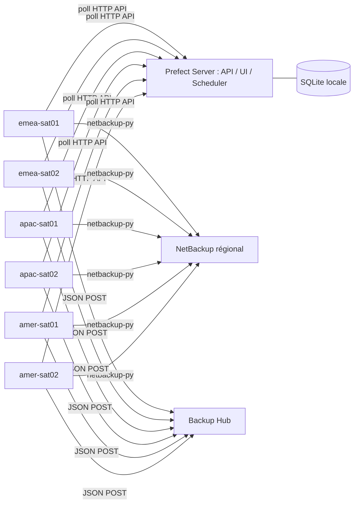

# Backup Orchestrator

Projet Python 3.12 / Prefect 3.8.8 pour orchestrer des collectes de sauvegarde depuis six satellites Linux. Un seul dépôt Bitbucket et un `.env` local par machine. Aucun conteneur, service Redis, broker ou interface personnalisée à installer.

Le serveur central héberge API, UI, scheduler et base Prefect. Les satellites exécutent les flows via des workers `process`. Le serveur ne collecte aucune donnée NetBackup.



## État de l'intégration

La partie Prefect, la validation, le traitement par lots et le transport HTTP sont implémentés. **Les six méthodes de `NetBackupCollector` sont volontairement non implémentées** : l'interface du module privé `netbackup-py` n'est pas disponible. Une collecte réelle échoue clairement tant que ce raccordement n'est pas effectué.

Le parser et le POST proposent une enveloppe JSON versionnée. Son format, l'authentification Bearer, l'acceptation complète d'un lot sur réponse 2xx et la déduplication doivent être confirmés avec Backup Hub. Voir [le contrat d'intégration](docs/integrations.md). Aucun résultat NetBackup fictif n'est produit.

## Structure

- `server/` : définition et registration reproductible de six pools et 24 deployments.
- `workers/common/` : configuration locale et validation des paramètres.
- `workers/collectors/` : accès aux technologies de sauvegarde.
- `workers/parsers/` : transformation JSON et lots.
- `workers/outputs/` : transport Backup Hub.
- `workers/flows/` : orchestration Prefect.
- `config/`, `scripts/`, `systemd/` : installation et services.
- `docs/`, `tests/` : exploitation et tests sans infrastructure NetBackup.

## Installation rapide

Prérequis : Linux avec systemd, Python 3.12, Git, accès aux dépôts de paquets et au dépôt Bitbucket, connectivité régionale. Installation de référence : Ubuntu 24.04, utilisateur `backup`, dossiers distincts `/data/backup-orchestrator/server` et `/data/backup-orchestrator/worker`.

Serveur : suivre [installation-server.md](docs/installation-server.md). Satellites : suivre [installation-worker.md](docs/installation-worker.md).

```bash
# Dans le clone sur le serveur
bash scripts/install_server.sh
# Éditer .env avant registration et lancement
venv/bin/python -m server.register
```

```bash
# Dans le clone sur chaque satellite
bash scripts/install_worker.sh
# Éditer .env et raccorder le module interne avant collecte réelle
venv/bin/python -m scripts.run_service worker
```

## Exécution manuelle et planification

Dans Prefect UI, sélectionner un deployment puis Run et renseigner les paramètres. Exemples :

```json
{"asset":"jobs","start_date":"2026-10-11T00:00:00Z","end_date":"2026-10-12T00:00:00Z"}
```

```json
{"asset":"image_contents","image_id":"IDENTIFIANT_IMAGE"}
```

Une seule date borne la requête d'un côté ; la gestion de cette borne appartient au véritable adaptateur. Les jobs/images sans dates demandent la portée par défaut du client, à définir avant production. Aucun calcul de période glissante implicite n'est inventé.

Les horaires sont dans le `.env` serveur. Réexécuter `python -m server.register` applique les modifications. Détails : [deployments.md](docs/deployments.md).

Pour mettre à jour, mettre le pool en pause, attendre la fin des runs, puis `bash scripts/update_worker.sh TAG_VALIDÉ`. Réactiver le pool après vérification. Le script conserve le worker arrêté si une étape échoue.

## Ajouter un collector

Ajouter un module `workers/collectors/datadomain.py`, un parser si nécessaire et un flow dédié appelant l'output commun. Définir ses deployments côté serveur. Aucune classe abstraite ni registre de plugins n'est nécessaire.

## Tests

```bash
python3.12 -m venv venv
venv/bin/pip install -r requirements-dev.txt
PREFECT_HOME="$PWD/.runtime/prefect" venv/bin/python -m pytest -q
```

Les données de tests sont des fixtures synthétiques. Les dépendances directes sont figées ; établir un verrou complet dans votre environnement Linux avant diffusion d'une version validée.

## Références Prefect

API et commandes contrôlées avec Prefect 3.8.8 et les sources officielles : [code local](https://docs.prefect.io/v3/how-to-guides/deployments/store-flow-code), [serveur](https://docs.prefect.io/v3/how-to-guides/self-hosted/server-cli), [SDK deployments](https://reference.prefect.io/prefect/deployments/runner/).

## Un seul dossier applicatif

Tout reste sous le clone, par exemple `/data/backup-orchestrator/server` pour le serveur et `/data/backup-orchestrator/worker` pour le worker : `.env`, `venv`, code et `.runtime/` (base SQLite, fichiers Prefect, profils, stockage, home technique, caches, temporaires et logs). Ces chemins sont calculés depuis le code et ne dépendent pas du répertoire courant. `.runtime/` est exclu de Git.

Pour utiliser `/data/autre-dossier`, cloner à cet emplacement et renseigner `WORKER_CODE_PATH` dans le `.env` serveur avec le chemin des clones satellites. `scripts/install_service.sh server|worker` génère le service dans `.runtime/systemd/` avec le chemin réel. L'exemple statique `prefect.yaml` doit aussi être adapté si vous l'utilisez à la place de la registration.

Les unités restent dans le dossier applicatif ; systemd crée uniquement les liens nécessaires dans `/etc/systemd/system`. Les logs applicatifs sont dans `.runtime/logs/prefect-server.log` et `.runtime/logs/prefect-worker.log` ; journald conserve les événements système du service. Python, Git et systemd restent des prérequis système.

Pour tester serveur et worker sur la même machine, suivre [development-local.md](docs/development-local.md). La télémétrie est désactivée dans les modèles `.env`.

Serveur et worker ont chacun un clone séparé du même dépôt, leur propre `.env`, `venv/` et `.runtime/`. Cela reste vrai sur une seule machine DEV. La base est uniquement dans le dossier serveur ; les workers n'hébergent pas de base Prefect. Ne pas partager un fichier `.env` ou un virtualenv entre les deux rôles.
